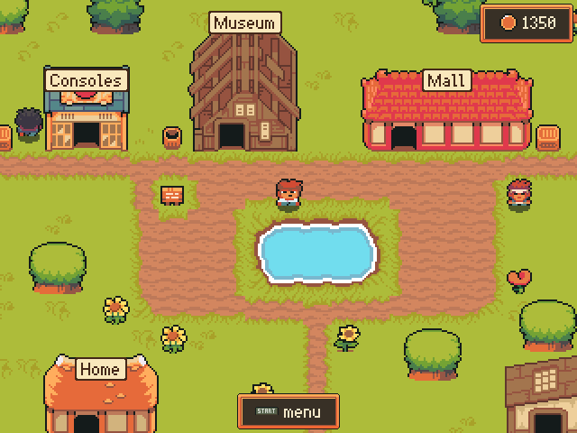
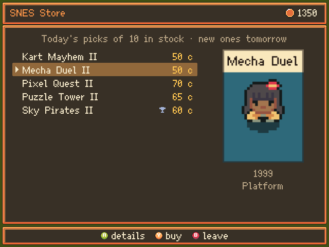

# Retro Town Story

 

Retro Town Story is a (meta)game for retro handhelds like the Anbernic RG 40XXV, to help players progressively unlock their game collection and choose what to play from it. It runs on EmulationStation (Knulli, Batocera), with other backends to follow.

The original idea came from PakUI's BitPal, which has the same aim. The twist here is a top-down RPG (like Pokémon) where the player walks around a town whose shops sell retro games.

The games come from the player's own collection and its scraped metadata, so stores show real covers and details. Coins to buy more games are earned by playing the games already owned (play time) and by unlocking RetroAchievements.

## In the game

- Start with only one console, three games and a few coins.
- Play your games to earn more coins. Unlock their RetroAchievements to earn a coin bonus.
- Spend coins on new consoles and games.
- Play and buy Arcade games at the Arcade Club, with new cabinets every week.
- Sell games you don't wish to play anymore.
- Watch trailers for new games on TV, or ask the townsfolk to suggest what to play next.
- Follow [retrohandhelds.gg](https://retrohandhelds.gg)'s GotX game club: its Games of the Month, Game of the Quarter and RetroBits are on the town's board, on loan to play while they're current, and for sale at the GotX Store.

## Installation

1. Download [v0.1.0](https://github.com/Arlanthir/retrotownstory/releases/download/v0.1.0/retrotownstory-0.1.0.zip) from the releases page.
2. Place it in `/userdata/system/.local/share/PortMaster/autoinstall` or unzip it to `/roms/ports` without creating extra folders.

## RetroAchievements Setup

To earn coins from achievements, create `retroachievements.txt` next to `retrotownstory.love` with your web API key from <https://retroachievements.org/settings>:

```
apikey=YOUR_WEB_API_KEY
username=YourUserName
```

- The file should be in `roms/ports/retrotownstory/` on the SD card.

---

## Donations

If you wish to send a token of your appreciation, you may do so via [Ko-Fi](https://ko-fi.com/arlanthir).

## Development

Built with [LÖVE](https://love2d.org) 11.5 and distributed as a PortMaster port.

- Run on desktop: `love src` (uses the mock backend; force one with `love src --backend mock`).
- Controls on keyboard: arrows, `Z`/`Enter` = A, `X`/`Esc` = B (hold to run), `A`/`S` = X/Y, `Q`/`W` = L/R, `Space` = Start, `Tab` = Select (hold for the FPS counter).
- Tests: `luarocks install busted`, then `busted` from the repo root.
- Screenshot: `love src --screenshot 2` saves `screenshot.png` to the LÖVE save folder after 2 seconds and quits.
- GotX: `scripts/update-gotx.sh` refreshes the GotX winners the game ships with (`src/assets/gotx/winners.tsv`); the game also fetches newer ones itself when a new pick is due.
- Port: `scripts/build-port.sh` builds `dist/ports/` (copy it to `/userdata/roms/ports/`) and `dist/retrotownstory-<version>.zip` (for PortMaster's installer). On its first run, the port adds its name, screenshot, box art and logo to EmulationStation. `scripts/port-art.sh` redraws that art in `port/`.

### Art

Town and menu art comes from the [Ninja Adventure asset pack](https://pixel-boy.itch.io/ninja-adventure-asset-pack) by Pixel-boy and AAA (CC0). The font is [Ark Pixel](https://github.com/TakWolf/ark-pixel-font) 10px (SIL Open Font License, see `src/assets/fonts/`), which also covers Japanese titles. Only the images in use are in `src/assets/ninja-adventure/`; the full pack can be unzipped into `example-data/ninja-adventure/` (ignored by git) to pick more. The TV, consoles, cabinets and sofa are the game's own, drawn in the pack's palette (`src/assets/retrotownstory/`).

### GotX data

The GotX picks come from the [GotX Randomizer](https://github.com/blakekl/gotx-randomizer)'s database (MIT), by the [retrohandhelds.gg](https://retrohandhelds.gg) community. Only the winners are kept: no nominations and no member data.

### AI Disclosure

The programming was AI-assisted by Claude.

## Wishlist

- Release date flashbacks (this game came out on this day X years ago!)
- Have some trivia about games.
- Have different types of store, like a more expensive "system sellers" store or a "deep cuts" / underrated game store for cheaper.
